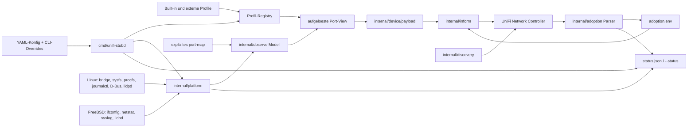

# Architektur

`unifi-stubd` ist ein controller-seitiger Geraete-Emulator. Er stellt einen
Linux-, FreeBSD- oder Bridge-artigen Host als minimalen UniFi-Switch oder als
experimentelle Gateway-Identitaet dar, ist aber kein Host-Provisioning-Agent.
Die Architektur trennt deshalb vier Verantwortungen, die unabhaengig bleiben
muessen:

- Konfiguration und Profilaufloesung;
- read-only Host-Observation;
- controller-seitiges Payload-Rendering;
- persistenter Adoption-State.

Die wichtigste Regel ist einfach: Controller-Daten duerfen lokalen Stub-State
aendern, aber keine Host-Netzwerke, Benutzer, Pakete, Services, Routen,
Firewall-Regeln oder Dateien ausserhalb der expliziten Stub-State-Pfade
veraendern.

## Komponenten-Graph

## Package-Ownership

| Package | Verantwortung | Darf nicht besitzen |
| --- | --- | --- |
| `cmd/unifi-stubd` | CLI, Config-Layering, Validierung, Daemon-Orchestrierung, Operation-Mode-Wiring | Packet-Encoding-Details, OS-spezifisches Parsing, Controller-Protokollinternas |
| `internal/config` | user-facing YAML-Schema, Defaults, striktes Config-Laden | Runtime-Netzwerkreads, Payload-Bau |
| `internal/device` | kanonische Profil-Structs, Built-in-/externe Profil-Registry, YAML-level `extends`, Validierung, Export/Templates, Portdefinitionen und Portaufloesung | Controller-HTTP, OS-Kommandos, JSON-Payload-Tabellenencoding |
| `internal/device/payload` | Switch-/Gateway-JSON-Payloads aus typisiertem Device-Profil, Identity und aufgeloesten Ports | Profil-Laden, Port-Erzeugung, modellbasierte Runtime-Ratespiele, Host-Netzwerk |
| `internal/observe` | normalisierte read-only Observations fuer Bridge- und Port-Map-Modi | direkte Linux-/FreeBSD-Kommandos ausserhalb der Adapter |
| `internal/platform` | read-only OS-Fassade fuer Interfaces, Bridges, LLDP, Logs, procfs, D-Bus, Capabilities | Payload-Rendering, Controller-Adoption-Entscheide |
| `internal/adapters/linuxbridge` | Linux-Bridge-FDB-Command-Parsing | Payload-Policy |
| `internal/adapters/freebsdifconfig` | FreeBSD-Bridge-/Interface-Parser-Helper | Payload-Policy |
| `internal/discovery` | UDP-Discovery-TLV-Bau | Adoption-State |
| `internal/inform` | `TNBU`-Framing, Padding, Verschluesselung, HTTP-Response-Limits | Profilaufloesung |
| `internal/adoption` | Controller-Response-Parsing und lokaler Adoption-Store | Ausfuehren von Controller-Shell-/Provisioning-Kommandos |
| `internal/adoptionssh` | minimaler SSH-Kompatibilitaets-Shim fuer Advanced Adoption | beliebige Shell-Ausfuehrung |

## Runtime-Flow

1. `cmd/unifi-stubd` baut Defaults aus `internal/config`.
2. YAML-Konfiguration wird geladen, falls konfiguriert. Unbekannte YAML-Felder
   sind Fehler.
3. Explizite CLI-Flags ueberschreiben YAML-Werte.
4. Built-in-Profile werden zuerst registriert; optionale `profile_file`- und
   `profile_dir`-Eintraege werden danach geladen.
5. Externes Profil-`extends` wird auf YAML-Mapping-Ebene aufgeloest und danach
   genau einmal in `device.Profile` decodiert. Dadurch bleiben
   absichtliche Zero-Value-Overrides wie `recommended: false`,
   `payload.has_dpi: false` oder `port_names: []` korrekt.
6. Jede Runtime-Instanz muss genau ein konkretes Profil per YAML oder
   `-profile` auswaehlen; eine leere oder unbekannte Auswahl wird verworfen.
7. Operation-Mode-Validierung prueft aufgeloestes Profil, Portanzahl,
   Management-LAN-Absicht, Bridge-/Port-Map-Einstellungen und Dry-Run-Faehigkeit.
8. Die Plattform-Fassade liest optionale Host-Fakten nur, wenn der gewaehlte
   Modus oder der Statuspfad sie braucht.
9. Profilports, konfigurierte Overrides, passive Observations, Management-LAN-
   Metadaten und Neighbor-Hints werden in `[]device.Port` gemergt.
10. `internal/device/payload` rendert daraus mit Profil und Identity den
   controller-seitigen JSON-Payload.
11. `internal/discovery` und `internal/inform` senden Discovery-/Inform-Traffic,
    ausser Validierung oder Dry-Run stoppen vor Netzwerk-I/O.
12. Controller-Antworten aktualisieren nur lokalen Adoption-Store und Status.

`-validate` nutzt dieselben Config-/Profil-/Operation-Pruefungen, sendet aber
keine Pakete, startet keine Listener und schreibt keine normalisierten Configs.

## Konfiguration und Profile

Konfiguration ist an der Service-Grenze absichtlich explizit. Die paketierte
YAML zeigt jedes unterstuetzte Feld mit konservativen Defaults. Runtime-Defaults
liegen in `internal/config.Default`, waehrend CLI-Registrierung und YAML-
Anwendung dieselbe Setting-Registry in `cmd/unifi-stubd/settings.go` nutzen.

Profile beschreiben die Geraeteform. Sie sind Daten, keine Code-Hooks. Ein
Profil besitzt:

- Modellidentitaet und Display-Metadaten;
- `device_type` und Payload-Art;
- Portanzahl, Namen, Rollen, Network-Groups, Medien und Speed-Layout;
- Payload-Defaults wie Management-Interface-Name, Gateway-Interface-Prefix,
  erforderliche Controller-Version und sichere Feature-Flags.

Getrennt davon besitzt das Device-Paket eine evidenzgebundene
`ProtocolProfile`-Registry fuer exakt analysierte Builds. Ihr unveraenderlicher
Schluessel enthaelt Familie, Plattform/Komponentenrolle, Version/Buildmarker,
Firmware-SHA-256, Komponenten-/App-SHA-256 und Digest-Art. Ein exakter Build
waehlt nur eine versionsunabhaengige `ProtocolBehaviorID`; ein getrennter
`ProtocolBehaviorProfile`-Katalog komponiert die sechs typisierten
Metadatenachsen: Wire, Discovery, Feldgruppen, Commands, positive Capabilities
und Presence. Der Lookup faellt nie auf Versionspraefix, Familienaehnlichkeit
oder einen benachbarten Digest zurueck. Eine unbekannte Build- oder
Verhaltens-ID waehlt die Komposition, deren sechs Achsen alle `unsupported`
sind.

Exakte Evidenzidentitaet und implementiertes Verhalten sind absichtlich zwei
verschiedene Ebenen. Eine Evidenzzeile erzeugt keinen vollstaendigen
firmwarespezifischen Verhaltenstyp. Sie waehlt stattdessen eine Komposition aus
kleinen wiederverwendbaren Vertraegen wie TNBU-Codec, Discovery-Dialekt,
gemeinsamen Identitaetsfeldern, Switch- oder Gateway-Feldgruppen,
Command-Namensraum, Plattform-Capabilities und Presence-Regeln. Builds mit
derselben belegten Semantik teilen diese Bausteine. Eine neue Firmwareversion
erzeugt erst dann einen neuen Verhaltensbaustein, wenn ein geprueftes
Differential eine relevante semantische Aenderung belegt.

Registry-Metadaten behalten Evidenzidentitaet und gewonnenes Prinzip fuer den
Review. Ausfuehrbarer Nachweis ist nur noetig, wenn Verhalten in ein benanntes
Produktrequirement uebernommen wird; reine Research-Selektoren erzeugen keine
eigenen Produkttests.

Protokollplattformen stammen nur aus der Architekturspalte von
`device-types.tsv`: `aarch64-little-endian`, `arm32-little-endian-eabi5`,
`mips32r2-little-endian`, `mips32r2-big-endian`, `mips32-big-endian`,
`arm-cortex-m-thumb-little-endian`, `xtensa-esp32-little-endian` und der
explizite Artefakt-only-Wert `unknown`. Exakter Subplattformtext bleibt im
Evidenz-Buildmarker, in Familie oder Komponentenrolle; daraus entsteht keine
neue Plattformklasse. Jeder Wert ausserhalb dieser Evidenztaxonomie faellt
geschlossen aus.

Verhaltensbausteine werden nach ihrem Vertrag oder ihrer Protokollgeneration
benannt, nicht nach jedem Produkt und Release. Produkt-/Buildnamen bleiben in
der Evidenzbindung. Plattformunterschiede werden als schmale Capabilities oder
Presence-Overlays modelliert; Mainline-BCM und -MSCC teilen zum Beispiel
dieselbe Switch-Basis und behalten trotzdem getrennte Plattform- und
Tabellen-Gates. Fehlende Capability-Flags behaupten nicht, dass physische
Hardware fehlt. Sie verhindern nur die Auswahl unbelegter Vokabeln oder
Verhalten. Ebenso ist der gemeinsame zlib-Wire-Baustein der kleinste sichere
controllerseitige Vertrag und aktiviert den beobachteten BCM-Snappy-Zweig
nicht. Mainline und Switch-WAN behalten wegen ihrer unterschiedlichen
Alternate-Builder getrennte Discovery-Bausteine. So entstehen weder unsichere
Naechstes-Profil-Fallbacks noch eine 1:1-Kopie der Firmwarematrix im
Produktcode.

Diese Registry ist der Selektorvertrag fuer spaetere Wire-, Discovery-,
Command- und Payload-Implementierungen. GOV-003 bindet die Forschungseintraege
nicht an die bestehenden benutzersichtbaren Formprofile und veraendert fuer
sich allein keinen aktuellen Runtime-Traffic.

Der Core ist ein Kompatibilitaetsstub, kein Firmware-Emulator und kein Vorhaben
fuer eine 1:1-Geraetesimulation. Er implementiert nur die kleinsten sicheren
controllerseitigen Vertraege, die fuer die ausgewaehlten Produktfaelle noetig
sind. Optionale synthetische Szenarien duerfen Adoption-State, Link-State,
Counter oder Command-Resultate fuer Tests deterministisch veraendern. Sie
bilden jedoch keine Vendorprozesse, internes IPC, Hardwarewirkungen,
zufaelliges Timing oder jedes beobachtete Payload nach. Reverse-Engineering-
Evidenz begrenzt diese Vertraege; sie ist keine zu kopierende
Implementierungsvorlage.

### Evidenz- und Produkt-Traceability

Reverse-Engineering-Evidenz ist Researchinput, kein automatischer
Produktvertrag. Verhalten, das in ein benanntes Requirement uebernommen wird,
behaelt die kleinste pruefbare Kette vom Requirement ueber das gewonnene
Prinzip zum Produktbaustein und ausfuehrbaren Produktnachweis. Zurueckgestellte,
abgelehnte oder ersetzte Lab-Erkenntnisse duerfen im Companion-
Researchprotokoll bleiben, ohne Produktcode oder Regressionstest zu verlangen.

Cleanup darf isolierte Patchfunktionen, Fixtures und Tests loeschen, wenn sie
kein angenommenes Produktverhalten schuetzen. Oeffentliches Produktergebnis und
Sicherheitsgrenze bleiben erhalten. Die Produktarchitektur entscheidet, was
implementiert wird, nicht die Groesse des Researchinventars.

Das Device-Paket ist die einzige Quelle fuer Profil- und Portdaten. Renderer-
spezifische Views werden aus `device.Profile` und `device.Port` abgeleitet; sie
sind keine eigenen Profil- oder Portmodelle.

Echte Daemon-Starts nutzen vor SSH, Discovery oder Inform eine host-globale
advisory Instanzsperre. `instance_guard: fail` ist der Default und bricht eine
zweite Live-Instanz auf demselben Host ab. Bewusste Multi-Stub-Labs muessen mit
`instance_guard: warn` oder `instance_guard: off` und geprueftem Lock-Pfad
explizit opt-in setzen.

Der Payload-Renderer darf nicht anhand von Modellnamen wie `UXG`, `UXGPRO` oder
`US48P500` Verhalten waehlen. Renderer-Verhalten wird durch Profilfelder
gesteuert: `payload.kind`, Port-Rollen, Port-Medien, Management-Interface und
explizite Overrides. Protokollspezifisches Rendering wird aus gemeinsamen
Feldgruppen, Capabilities und Presence-Regeln zusammengesetzt, nicht aus einem
vollstaendigen Schema pro Firmwarebuild.

## Operation-Modi

### `stub`

`stub` ist synthetisch. Der Modus nutzt Profildaten, konfigurierte Nachbarn,
optionale Port-Overrides und generierte Zaehler. Eine Bridge wird nur gelesen,
wenn explizite Legacy-Observation-Flags aus Kompatibilitaetsgruenden gesetzt
sind.

### `bridge-observe`

`bridge-observe` stellt eine Host-Bridge als virtuellen UniFi-Switch dar. Die
Bridge ist die Beobachtungsgrenze. Der Modus ist read-only: VLANs, Bridges,
Routen oder Interfaces werden nicht veraendert.

Der Bridge-Member-Classifier vergibt Rollen, bevor MACs in den Payload gelangen:

- `bridge`: das Bridge-Device selbst, gespeichert als Metadatum, kein UniFi-Port;
- `uplink`: das konfigurierte physische Upstream-Interface oder der einzige
  sichere physisch wirkende Kandidat, wenn kein expliziter Uplink gesetzt ist;
- `access`: VM-/Container-artige Member wie `tap*`, `veth*`, `fwpr*`, `fwln*`,
  `fwbr*`, `epair*` und `vnet*`;
- `unknown`: bleibt fuer deterministisches Mapping geeignet, wenn die Plattform
  nicht sicher klassifizieren kann;
- `ignored`: wird vom Payload-Mapping ausgeschlossen.

MACs, die auf dem Uplink gelernt werden, liegen remote hinter dem echten
Upstream-Switch und werden aus lokalen Access-Port-MAC-Tabellen herausgefiltert.
Ungenutzte Profilports werden getrennt gemeldet, nicht synthetisch up. Dadurch
sieht der Controller den Upstream-Switch oder dessen Downstream-Clients nicht
als direkt am virtuellen Stub-Switch angeschlossen.

`uplink_port` bestimmt, welcher Profilport den dargestellten physischen Uplink
traegt. Das ist bei Mixed-Speed-Profilen wichtig: Ein 48-Port-Switch mit
SFP-/SFP+-Cages sollte einen 10G-Upstream auf den vorgesehenen SFP+-Port legen,
nicht versehentlich auf den letzten GE-Port.

### `port-map`

`port-map` braucht pro Profilport genau eine explizite Quelle:

- `interface`: ein Host-Interface lesen und MAC, IP, Link, Speed/Media und
  Counter uebernehmen, soweit verfuegbar;
- `disabled`: Link down und Speed `0` rendern;
- `unmapped`: Profil-Defaults behalten, ohne physische Sensorquelle.

Dieser Modus ist fuer Appliances oder VMs gedacht, bei denen jeder dargestellte
UniFi-Port auf eine bekannte Host-NIC mappt. Auch dieser Modus ist read-only.

## Plattform-Fassade

`internal/platform` ist die einzige Runtime-Grenze, die optionale Host-
Funktionen ansprechen darf. Sie stellt kleine Interfaces bereit:

- `InterfaceReader` fuer Link-State, Adressen, Speed/Media und Counter;
- `BridgeReader` ueber `observe.ObservationSource`;
- `LLDPReader` fuer passives `lldpcli -f json show neighbors`;
- `LogReader` fuer `journalctl` oder Syslog-Dateien;
- `ProcReader` fuer Linux-`/proc/net/dev`-Counter;
- `ServiceBus` fuer optionale D-Bus-Capability-Pruefungen.

Die Plattform-Schicht meldet Capability-State als `disabled`, `available`,
`missing` oder `unsupported`. Fehlende optionale Tools sind Status-Warnungen,
kein Grund fuer Host-Mutation oder Dependency-Installation.

## Payload-Grenze

Payload-Rendering startet erst nach Profil- und Observation-Aufloesung. Der
Renderer erhaelt:

- das aufgeloeste `device.Profile`;
- controller-seitige Identity;
- eine geordnete, aufgeloeste Portliste.

Switch-Payloads leiten `if_table`, `ethernet_table` und `port_table` aus diesen
Daten ab. Gateway-Payloads leiten `if_table`, `network_table`, `port_table`,
`config_port_table`, `ethernet_overrides`, `uplink_table`, `reported_networks`
und WAN-Statuszeilen aus denselben Daten ab. Explizit konfigurierte
Zuweisungsmetadaten wie `portconf_id`, `networkconf_id`,
`native_networkconf_id`, `network_name` und `vlan` koennen in den
Gateway-Porttabellen gespiegelt werden. Dadurch bleiben Speed, Medium, MAC, IP,
Source-Interface, WAN-/LAN-Rolle, Network-Group, Counter,
MAC-Table-Eintraege und Management-LAN-Metadaten synchron.
Bei Switches werden die Counter und explizit gemessenen Raten des ausgewaehlten
physischen Uplinks zusaetzlich auf die vom Top-Level-`uplink` benannte
Management-`if_table`-Zeile projiziert; die lokale Source-Interface-Identity
bleibt in der physischen Portansicht.

Management-LAN ist Payload-Metadatum oder Bindung an ein bereits bestehendes
lokales Interface. `planned-host-vlan` bleibt nur Dry-Run-Plan. Der Daemon legt
keine Host-VLANs an.

## Controller-Grenze

Das controller-seitige Protokoll hat drei getrennte Pfade:

- UDP-Discovery meldet die Fake-Geraeteidentitaet;
- HTTP-Inform sendet verschluesselte `TNBU`-Payloads und empfaengt Adoption-/
  Provisioning-Antworten;
- der optionale SSH-Shim akzeptiert nur die minimalen Kommandos fuer Advanced-
  Adoption-Kompatibilitaet.

Die Payload-Grenze besitzt die exakten typisierten Inform-States `0 Unknown`,
`1 Default`, `2 Managed`, `3 Selfrun` und `4 Upgrade`. Der aktive Adoption-
Lifecycle ist der beobachtete UXG-Pro-Pfad `1 -> 0 -> 2`: Der akzeptierte Key-/
Cipher-Wechsel laesst den unmittelbar folgenden Inform State `0` verwenden;
das im Capture folgende `noop` fuehrt zu State `2`. Statische
Firmwareanalyse zeigt, dass erfolgreiche `noop`- und `setparam`-Antworten
Managed setzen, bevor ein `setparam` mit Authkey oder eine geaenderte Inform-URL
den Reporter wieder auf Unknown fuehrt. Die frueheren synthetischen Restart-
Ketten sind damit nicht belegt. States `3` und `4` sind im Stub nur
Statusvokabular und erlauben keine Host-Aktion.

Akzeptierte Controller-Adoption-Konfiguration darf die Allowlist-Felder
`AUTHKEY`, `CFGVERSION`, `USE_AES_GCM` und `INFORM_URL` aktualisieren; das
Produkt leitet `STATE` aus diesen akzeptierten Uebergaengen ab. Persistiertes
`VERSION` ist ein Legacy-Feld, dessen Herkunft in aelteren Releases
controllergelernt sein kann. Es wird aus Kompatibilitaetsgruenden gelesen;
fehlt es, gilt die ueber Profil/Flag gewaehlte Betreiber-Version. Eine
Controller-Antwort `_type: upgrade` wird nur als
ignorierter Status festgehalten; sie schreibt weder die advertisierte
Betreiber-Version noch Lifecycle-State, Firmware, Services oder Host um.

Der Stub darf seinen eigenen lokalen Adoption-State loeschen, bildet eine
Controller-Reset-Anfrage aber nie auf Vendor-Factory-Reset, Host-Restart,
Netzwerk-, Dienst- oder Uhraenderung ab. Das ist eine lokale Sicherheitsgrenze
und kein rekonstruierter Firmware-Lifecycle.

Blockauswahl und Controller-Zeit sind prozesslokale Reporting-Eingaben. Jedes
akzeptierte `noop` ersetzt die vorherige Blockauswahl vollstaendig; jeder
Payload-Producer prueft nur seine eigenen exakten Include-/Exclude-Bezeichner.
Ein String `server_time_in_utc` auf `noop` setzt einen Controller-minus-Device-
Offset ausschliesslich fuer die spaeter gemeldete Payload-Zeit. Weder
Blockdeskriptoren noch Controller-Zeit koennen Kommandos ausfuehren oder den
Host veraendern.

Provisioning-Kommandos, die den Host betreffen wuerden, werden nur als
ignorierte Metadaten zusammengefasst. Beliebige Controller-Shell-Kommandos
werden nicht ausgefuehrt. Die einzige Command-Result-Ausnahme ist ein
argumentfreies `wg-genkeypair` mit Request-ID: Der Daemon erzeugt prozessintern
ein X25519-Keypaar und haengt das korrelierte Ergebnis an den naechsten Inform.
Keys und Request-ID bleiben nur im Speicher; Logs und Status enthalten nur den
festen Kommandonamen und bereinigte Lifecycle-Zaehler.
Bereinigter Adoption- und Last-Inform-Status zeigen sowohl den numerischen
Wire-State als auch dessen festen Namen, niemals jedoch den individuellen
Adoption-Key.

Der Presence-Loop verwendet statt eines festen Tickers einen ruecksetzbaren
Timer. `interval_seconds` des Betreibers ist der Starttakt. Positive Controller-
Hinweise aus `noop.interval` sind nur aktiv, wenn Built-in-Quelle, Profil,
Modell, Version und Boardidentitaet eine exakte LIFE-010-Firmwareminimum-Bindung
waehlen. Der aktuelle Kandidat aktiviert sechs exakte Tupel und laesst die
anderen sechs Built-ins, externe Profile, benachbarte Identitaeten sowie Modell-
oder Versions-Overrides fuer Intervallhinweise geschlossen. Die exakte Liste
steht in den Protocol Notes.

Bei einem aktivierten Tupel ist die Untergrenze
`max(Firmwareminimum, Betreiberminimum)` und die Obergrenze
`min(Betreibermaximum, 300 Sekunden)`. Ohne Bindung wird ein positiver Hinweis
ignoriert und die Betreiberbasis bleibt aktiv. Die Konfiguration scheitert an
der Validierung, wenn die effektive Obergrenze unter der effektiven Untergrenze
liegt. Dry-Run-Plan und bereinigter Status zeigen, ob Hinweise unterstuetzt
sind, die Evidence-ID, Firmware- und effektives Minimum oder den festen
Ablehnungsgrund. `noop.immediate=true`
fordert genau einen begrenzten, von null verschiedenen, nahezu unmittelbaren
Folge-Inform an, ohne den beibehaltenen effektiven Takt zu veraendern.
Transport-, Response-Decode-, JSON-, Dispatcher- und Nicht-200-Fehler
verdoppeln den effektiven Takt bis zum konfigurierten Backoff-Maximum und
ergaenzen begrenzten symmetrischen Jitter. Nur ein leeres HTTP 200 oder ein 200
mit akzeptiertem Controllerobjekt setzt den Fehlerzaehler zurueck; effektiver
Takt, naechste Wartezeit, Fehlerzaehler und Backoff-State werden bereinigt im
Status erfasst.

Die exakten Intervallbindungen bleiben Kandidatenverhalten, bis der
ausgewaehlte Produktkandidat in seiner vorgesehenen Controllerumgebung
abgenommen ist.

## Persistenz und Status

Persistenter State ist absichtlich eng:

| Datei | Zweck |
| --- | --- |
| `/var/lib/unifi-stubd/adoption.env` | Linux-Adoption-Store: State, Authkey, cfgversion, Inform-URL, Cipher-Praeferenz |
| `/var/lib/unifi-stubd/status.json` | Linux-sanitized Runtime-Status |
| `/var/db/unifi-stubd/adoption.env` | FreeBSD-Adoption-Store |
| `/var/db/unifi-stubd/status.json` | FreeBSD-sanitized Runtime-Status |

Adoption- und Runtime-Status-Updates werden in temporaere Dateien im selben
Verzeichnis geschrieben, synchronisiert und atomisch umbenannt. Ein
unterbrochenes Update laesst dadurch die vorherige vollstaendige State-Datei
bestehen, statt Teildaten sichtbar zu machen. `SIGINT` und `SIGTERM` beenden den
Daemon beide ueber seinen normalen Aufraeumpfad.

Status-Ausgabe muss fuer Betreiber nuetzlich, aber teilbar bleiben. Sie meldet
Identity, gewaehltes Profil, Operation-Mode, Observation-Zusammenfassung,
Plattform-Capabilities und letztes Inform-Ergebnis. Sie darf keine Adoption-
Authkeys, Controller-Tokens, SSH-Passwoerter, privaten Captures oder rohen
Lab-Secrets ausgeben.

## Topologie-Grenzen

UniFi Network berechnet Topologie-Links aus mehreren controller-seitigen
Signalen. Der Stub kann Hinweise liefern, aber den Controller-Graph nicht
vollstaendig kontrollieren.

Die Topologieaufloesung trennt direkte Infrastruktur-Nachbarn von Client-/FDB-
MAC-Zeilen. Der aktive dargestellte Uplink bestimmt die Upstream-Richtung;
direkte Infrastruktur an anderen Ports ist downstream. Konfigurierte Nachbarn
gewinnen vor LLDP, waehrend FDB-Sichtbarkeit niemals die Richtung bestimmt.
Switch-Renderer melden den ausgewaehlten Upstream ueber `uplink` und
`last_uplink` und lassen Downstream-Infrastruktur am physischen Port. Reale
Geraete- und Port-MACs bleiben dabei unveraenderte Identitaeten.

LLDP ist hilfreich, aber optional. Ohne LLDP bleibt `uplink_neighbor` manuell.
Mit LLDP sollte Nachbarerkennung manuelle Fehler reduzieren, aber der Controller
besitzt weiterhin das finale Topologie-Rendering.

## Safety-Regeln

Diese Regeln sind architektonisch, nicht nur Implementierungsstil:

- kein controller-seitiges Shell-Kommando wird als Shell ausgefuehrt;
- kein Controller-Provisioning wird auf Host-Netzwerk angewandt;
- kein Package-Manager, Service-Manager, Firewall-, Routing- oder User-Store
  wird durch Adoption veraendert;
- `bridge-observe` und `port-map` sind read-only Observations;
- `management_lan` legt in dieser Version keine VLAN-Devices an;
- private Controller-URLs, Tokens, echte MAC-Tabellen und Captures bleiben aus
  Git heraus;
- Profilwechsel unter derselben MAC werden nicht migriert; nutze neue Fake-MAC,
  Controller-Forget oder lokalen Reset.

## OS-Support-Matrix

| Quelle | Linux | FreeBSD/OPNsense |
| --- | --- | --- |
| `stub`-Profilpayload | unterstuetzt | unterstuetzt |
| `bridge-observe` FDB | `bridge fdb show br <bridge>` plus Member-Rollenklassifikation | Parser fuer `ifconfig <bridge> addr` plus dasselbe Member-Rollenmodell; Runtime-Paritaet bleibt konservativ |
| `bridge-observe` Counter/Speed | `/sys/class/net`, optionale `/proc/net/dev`-Counter | reichere Bridge-Counter geplant; `port-map` kann Interface-Metadaten lesen |
| `port-map` Interface-Metadaten | `net.Interface`, sysfs, optionale Command-Fallbacks | `net.Interface`, optional `ifconfig`/`netstat` |
| passives LLDP | `lldpcli -f json show neighbors` | `lldpcli -f json show neighbors`, wenn lldpd installiert ist |
| Logs | optional `journalctl --output=json` | optionale Syslog-Datei, Default `/var/log/messages` |
| D-Bus | optionale System-/Session-Bus-Pruefung | optionale Best-Effort-Pruefung |
| Event-Subscription | geplant | geplant |
| Native Helper/C++ | nicht genutzt | nicht genutzt |

## Bekannte Erweiterungspunkte

- `uplink_neighbor.remote_port` als explizite Topologie-Metadaten.
- LLDP-abgeleitete Uplink-Nachbarwahl mit manuellem Override.
- reichere FreeBSD-Media-/Counter-Reader, eventuell ueber `x/sys/unix`.
- Event-Subscriptions fuer Bridge-/FDB-Aenderungen statt Polling.
- aktiver macvlan-/ipvlan- oder VLAN-Lifecycle nur nach separatem Review-Design.
